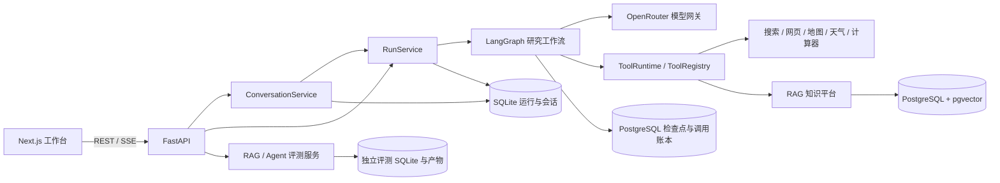

# AtlasFlow

基于 **LangGraph、FastAPI 和 Next.js** 的多 Agent 研究平台。围绕“提出需求 → 规划与审批 → 检索与研究 → 审查 → 交付报告”构建完整流程，支持多轮研究会话、可追溯知识库、执行恢复和独立评测。

[版本迭代](CHANGELOG.md) · [运行依赖](requirements.txt) · [开发依赖](requirements-dev.txt) · [配置模板](.env.example)

## 项目能力

| 模块 | 已实现内容 |
| --- | --- |
| 多 Agent 编排 | 任务 DAG、依赖校验、并行调度、人工审批、补充研究、重规划、报告局部修订 |
| 研究会话 | 澄清需求、解释已有报告、确认后创建研究、累计更新报告、历史版本与会话删除 |
| 工具系统 | 网页搜索、网页读取、知识检索、算术计算、高德路线、行程规划、POI 核对与天气 |
| RAG 知识库 | 异步文档导入、结构化父子切块、双语查询扩展、混合检索、重排序、空间版本与原子发布 |
| 报告交付 | 编号引用、确定性参考文献、集中展示局限、Markdown / HTML 下载及浏览器打印 |
| 运行观测 | SSE 事件、执行拓扑、任务状态、工具记录、证据、模型消耗和可选 LangSmith Trace |
| 执行恢复 | PostgreSQL 检查点、调用账本、持久化预算、中断对账与人工确认恢复 |
| 评测实验 | RAG 检索 / 回答评测、Agent 任务 / 契约评测、多配置对照、逐题详情和 JSON / CSV 导出 |

技术栈：Python 3.11+、LangGraph、Pydantic、FastAPI、SQLAlchemy / Alembic、PostgreSQL / pgvector、SQLite；前端使用 Next.js 15、React 19、TypeScript、React Flow 和 Recharts。Python 配置见 [pyproject.toml](pyproject.toml)，前端依赖见 [frontend/package.json](frontend/package.json)。

## 系统与工作流



标准研究路径：

```text
Supervisor → Planner → Approval → Scheduler ⇄ Researcher
                                         ↓
                                  Research Gate
                                         ↓
                                      Critic
                                         ↓
                                   Synthesizer
                                         ↓
                                   Quality Gate → Finalizer
```

- **Planner**：输出带任务目标、验收标准、依赖和能力要求的结构化计划；调度器按依赖分波并行执行。
- **Approval**：暂停等待接受、拒绝或带反馈重规划；支持显式配置自动审批。
- **Researcher / Research Gate**：通过工具取得 Evidence，检查任务完成情况、重试上限及进入后续阶段的条件。
- **Critic**：检查研究覆盖与证据缺口，可接受、增加补充任务或在关键问题下重规划。
- **Synthesizer / Quality Gate**：根据证据成稿、检查章节与引用，必要时局部修订；Finalizer 保存报告与真实终态。

会话层将消息路由为 `clarify / answer / research / revise`。澄清和解释已有报告不创建研究 Run；研究或修订需明确确认，生成独立 Run 并保留当时的需求快照。补充研究累积旧报告与新证据；仅表达修订可走 `Supervisor → Synthesizer → Quality Gate`，不重复检索。

默认上限为初始 2–5 个任务、并发 3、任务尝试 2 次、补充 1 轮、重规划 1 次、报告修订 1 次；单次 Agent 工具阶段默认最多 10 次调用、每个 Run 默认 40 次，部分角色另有更小上限。具体预算由 `.env` 和 `RunPolicy` 约束，历史 Run 的策略不会随新默认值被改写。

核心实现：[工作流](backend/src/atlasflow/agents/workflow.py)、[运行服务](backend/src/atlasflow/service.py)、[会话服务](backend/src/atlasflow/conversations/service.py)、[执行恢复](backend/src/atlasflow/execution/runtime.py)。

## 知识库与工具

文档与检索的数据流：

```text
文本 / Markdown / HTML / PDF
  → 原文件保存与内容去重 → 结构解析 → 父子切块 → Embedding → 索引发布
查询 + 固定知识快照
  → 规范化与中英术语扩展 → BM25 / 向量余弦双路召回
  → 加权 RRF → Rerank → 父块邻域与去重 → Evidence + 检索诊断
```

- 文件上传上限为 **25 MB**；PDF 使用 `pypdf` 提取文字，没有 OCR。解析结果保留页码、章节、块顺序和来源定位。
- 子块用于召回，父块补充上下文；中英扩展保留原查询，只在查询时执行，不重建索引。
- 检索实验台可调整词法 / 向量权重、候选数、重排开关及查询扩展；分数是排序与诊断信号，不等同答案正确率。
- 文档版本、索引世代和整空间快照分别记录。整空间重建先暂存，全部完成后显式发布，避免检索读到半成品；可以查看或切换历史空间版本。
- 索引记录 Embedding 模型、实际维度和解析 / 切块配置。模型或维度不兼容时明确拒绝语义检索或记录词法降级；重排失败也会保留降级诊断。

| 工具名称 | 用途 | 外部配置 |
| --- | --- | --- |
| `knowledge_search` | 查询所选知识空间，返回上下文和检索诊断 | Embedding / Rerank 配置及已发布文档 |
| `web_search` | 网页搜索与 URL 来源证据 | OpenRouter；可复用 LLM 配置 |
| `web_fetch` | 读取指定网页，生成正文摘录 | 可访问的 HTTP / HTTPS 页面 |
| `calculator` | 受限 AST 算术计算 | 无 |
| `map_route` / `map_itinerary` | 两点路线 / 多站行程及导航链接 | `AMAP_API_KEY` |
| `poi_details` | 地点信息与景点核对 | `AMAP_API_KEY` |
| `weather_forecast` | 地理编码与天气预报 | Open-Meteo；订阅接口可配 Key |

工具统一经过参数校验、角色与风险检查、预算、超时、有限重试和结果审计。地图结果区分地点解析与已核验路段；网页结果区分搜索摘要和实际读取正文。原始高德候选与坐标不写入运行记录或报告，保留允许的导航链接和安全状态。

## 安装与启动

以下以 Windows PowerShell、Python 3.11、Node.js 22 和 `E:\codex\agent` 为例。准备 Conda、npm 和可运行的 Docker Engine / Compose；也可连接已有 PostgreSQL / pgvector。使用其他路径时，同步修改 `.env` 和 Compose 的存储目录。

### 1. 安装后端

已有项目目录可跳过克隆；已有 Python 3.11+ 环境可跳过创建环境。

```powershell
git clone https://github.com/blank567/AtlasFlow_agent.git E:\codex\agent
Set-Location E:\codex\agent

New-Item -ItemType Directory -Force E:\codex\tmp | Out-Null
$env:TEMP = 'E:\codex\tmp'
$env:TMP = 'E:\codex\tmp'
$env:CONDA_PKGS_DIRS = 'E:\codex\cache\conda\pkgs'
$env:PIP_CACHE_DIR = 'E:\codex\agent\.pip-cache'

conda create -p E:\conda_envs\atlasflow python=3.11 -y
conda activate E:\conda_envs\atlasflow
python -m pip install -r requirements.txt
```

`requirements.txt` 明确列出运行依赖及版本范围，并通过 `-e .` 安装 AtlasFlow 包与 CLI；`requirements-dev.txt` 在此基础上增加 pytest、pytest-asyncio 和 Ruff。两份清单与 `pyproject.toml` 保持一致，前端依赖由 npm 单独管理。

### 2. 配置 `.env`

```powershell
if (!(Test-Path .env)) { Copy-Item .env.example .env }
```

编辑根目录 `.env`，不要覆盖已有密钥：

| 配置 | 说明 |
| --- | --- |
| `LLM_MODEL` / `LLM_API_KEY` / `LLM_BASE_URL` | 主模型，需支持 JSON Schema 结构化输出与工具调用 |
| `EMBEDDING_MODEL` / `EMBEDDING_API_KEY` / `EMBEDDING_BASE_URL` | 文档与查询向量化 |
| `RERANK_MODEL` / `RERANK_API_KEY` / `RERANK_BASE_URL` | 检索重排序 |
| `SEARCH_MODEL` / `SEARCH_API_KEY` | 留空复用 LLM；`SEARCH_BASE_URL` 见模板 |
| `KNOWLEDGE_DATABASE_URL` | PostgreSQL 知识库连接，模板匹配 Compose 默认配置 |
| `EXECUTION_DATABASE_URL` | 留空复用知识库数据库，执行数据位于独立 schema |
| `DATABASE_PATH` / `KNOWLEDGE_BLOB_ROOT` / `KNOWLEDGE_WORK_ROOT` / `EVALUATION_STORAGE_ROOT` | SQLite、原文件、工作目录与评测数据路径 |
| `AMAP_API_KEY` / `OPEN_METEO_API_KEY` | 可选地图及天气订阅配置 |
| `LANGSMITH_TRACING` / `LANGSMITH_API_KEY` | 可选链路追踪；正文上传由 `LANGSMITH_TRACE_CONTENT` 单独控制，默认关闭 |
| `LLM_MODEL_OPTIONS` / `EVALUATION_JUDGE_*` | 可选评测模型列表和独立 Judge，缺省可复用主模型配置 |

当前运行时装配 OpenRouter Provider，启动需要 LLM、Embedding、Rerank 的模型与密钥；配置模板中的模型标识需在自己的账户中可用。模型、Embedding、搜索和在线评测使用真实服务，可能产生费用；测试替身仅由测试代码注入。

### 3. 准备数据库

确认 Docker Engine 的数据目录位于 E 盘，在项目根目录执行：

```powershell
$env:DOCKER_CONFIG = 'E:\codex\agent\.docker'
docker compose up -d postgres
docker compose ps
```

等待 PostgreSQL 显示 `healthy`，再在已激活的 Python 环境中执行：

```powershell
python -m alembic upgrade head
python scripts/init_execution_store.py
```

两步分别完成知识 / 执行业务表迁移和官方 Checkpointer 表初始化。**首次启动必须完成，API 不会自动创建这些 PostgreSQL 表**；升级已有实例前先停止旧 API / Worker。`EXECUTION_DATABASE_URL` 若另指数据库，初始化脚本会在该数据库创建执行存储。

Compose 默认使用 `pgvector/pgvector:pg16`，数据库数据目录为 `E:/codex/agent/data/postgres`；可用 `ATLASFLOW_POSTGRES_DATA` 覆盖。独立版 Compose 使用 `docker-compose` 替代 `docker compose`。

### 4. 启动 API

在项目根目录、已激活的 Python 环境中执行：

```powershell
python -m uvicorn atlasflow.main:create_app --factory --app-dir backend/src --host 127.0.0.1 --port 8000
```

开发时可加 `--reload`。执行存储对同一数据库 / schema 持有单进程锁，不配置多个 Uvicorn Worker。默认 `KNOWLEDGE_WORKER_ENABLED=true`，API 内置知识导入 Worker；如需独立运行，先将该项设为 `false`，再另启 `python -m atlasflow.knowledge.worker`。

### 5. 启动前端

另开终端：

```powershell
Set-Location E:\codex\agent\frontend
$env:TEMP = 'E:\codex\tmp'
$env:TMP = 'E:\codex\tmp'
npm ci --cache E:\codex\agent\.npm-cache
npm run dev
```

打开 [Web 工作台](http://localhost:3000)、[Swagger](http://localhost:8000/docs) 或 [健康检查](http://localhost:8000/api/v1/health)。前端默认请求 `http://localhost:8000/api/v1`，自定义地址通过前端环境变量 `NEXT_PUBLIC_API_URL` 设置；当前 API 的 CORS 允许本机 3000 端口。

开发模式会按需编译页面。使用生产构建时，在前端目录执行 `npm run build`，成功后执行 `npm run start`。

## 页面与使用顺序

| 页面 | 路径 | 用途 |
| --- | --- | --- |
| 工作台 | `/` | 创建独立研究 Run，选择审批、工具预算与知识空间 |
| 研究会话 | `/conversations` | 澄清 → 确认研究 → 审批 → 阅读报告 → 追问或修订 |
| 运行记录 | `/runs` | 查看事件、任务、证据、报告；取消、重跑或恢复运行 |
| 知识库 | `/knowledge` | 创建空间、导入文档、版本管理与整空间重建 |
| 导入任务 / 检索实验台 | `/knowledge/jobs` / `/knowledge/lab` | 查看任务错误与重试；调节检索参数和检查命中上下文 |
| RAG / Agent 评测 | `/evaluations/rag` / `/evaluations/agent` | 配置实验、预检、执行、逐题查看与结果对照 |
| 统计 / 设置 | `/analytics` / `/settings` | 运行统计与 Provider、数据库、LangSmith 配置状态 |

知识库初始为空，不附带论文原文、预生成向量或真实评测结果。先导入并等待索引发布，再在研究或评测中选择对应空间。语料候选见 [corpus_manifests/llm-engineering-v1.yaml](corpus_manifests/llm-engineering-v1.yaml)，不会在启动时自动下载。


## 开发、测试与 Studio

在项目根目录、已激活的 Python 环境中执行；缓存与临时目录沿用安装步骤的 E 盘设置：

```powershell
python -m pip install -r requirements-dev.txt
python -m pytest
python -m ruff check .
```

默认测试使用注入的 Provider 替身，不执行真实研究；PostgreSQL 专项通过 `ATLASFLOW_TEST_DATABASE_URL` 指向独立测试库后启用。真实 Provider / 工作流冒烟脚本见 `scripts/live_provider_smoke.py` 与 `scripts/live_workflow_smoke.py`，运行会产生外部请求。

前端目录中执行：

```powershell
npm run typecheck
npm run test:flow
npm run test:ui
npm run test:report
npm run test:evaluations:chart
npm run test:retrieval:controls
npm run build
```

浏览器验证脚本及其他命令见 `frontend/scripts/` 和 `frontend/package.json`。可选 LangGraph Studio：

```powershell
python -m pip install -e ".[studio]"
langgraph dev --config langgraph.json --host 127.0.0.1 --port 2024 --no-browser --no-reload
```

Studio 使用同一研究图，但线程和检查点由 Studio 管理，不写入 FastAPI 的 Run / Event 数据库；当前 Studio 入口未装配 `knowledge_search`，不能替代主程序的 RAG 与恢复验证。现有 `scripts/start-studio.ps1` 专用于 `E:\conda_envs\langchain` 环境，其他环境使用上面的 CLI 命令。

其他维护工具：`scripts/import_llm_corpus.py` 显式下载 / 导入语料，`scripts/reindex_knowledge.py` 预览 / 暂存 / 发布整空间重建，`scripts/backfill_space_versions.py` 补建历史空间快照。先用 `--help` 查看参数；导入和重建会使用 Embedding 服务。

## 数据存储与当前边界

| 数据 | 存储位置 / 配置 |
| --- | --- |
| Run、事件、运行投影、会话与消息 | SQLite，`DATABASE_PATH` |
| 知识空间、文档版本、Chunk、向量、空间快照与构建 | PostgreSQL / pgvector，`KNOWLEDGE_DATABASE_URL` |
| 执行控制、调用账本、Outbox、LangGraph 检查点 | PostgreSQL，`EXECUTION_DATABASE_URL`，默认 `atlasflow_execution` schema |
| 原始文档与解析工作目录 | `KNOWLEDGE_BLOB_ROOT` / `KNOWLEDGE_WORK_ROOT` |

- 面向本地单用户、单进程使用；尚无用户认证、多租户隔离或分布式调度。备份需同时保留 SQLite、PostgreSQL 与相应文件。
- 研究中断后先对账，再人工确认恢复；远端结果未知的调用可能需要确认重试，不保证跨 SQLite、PostgreSQL 与外部服务的“恰好一次”。代码 / 模型 / 配置身份不兼容时需新建 Run。
- 关键事实仍需证据支持；`completed_with_warnings` 表示带真实缺口交付，不能当成完整质量验收通过。报告保留局限，不会因只读旧报告而重新调用模型。
- 当前词法与向量相似度主要在应用侧计算，未实现数据库侧 ANN / Top-K 优化；pgvector 存储不代表已经验证大规模检索性能。
- 最新功能迭代为 Git 中的 `v0.8.1`；Python 与前端包元数据目前仍为 `0.8.0`，详见版本记录。

## 项目结构

```text
backend/src/atlasflow/
├── agents/           # 工作流、模型网关、任务验收与报告审查
├── conversations/    # 会话协议、需求快照、确认与报告关联
├── tools/            # 工具契约、注册表与各工具实现
├── knowledge/        # 领域模型、解析切块、检索、存储、导入 Worker
├── execution/        # 检查点、调用账本、预算与恢复
├── evaluation/       # RAG / Agent 评测协议、指标、存储与 API
├── providers/        # OpenRouter 客户端与 Embedding 兼容性校验
├── skills/           # 应用内 academic-report 写作与引用规则
├── api/              # 运行管理、SSE、配置状态与统计接口
├── bootstrap.py      # 默认真实 Provider 与模块装配
├── storage.py        # SQLite 运行存储
├── observability.py  # Trace、脱敏与模型消耗
├── studio.py         # 独立 Studio 图入口
└── main.py           # FastAPI 工厂与应用生命周期
backend/tests/        # 单元、API、恢复与 PostgreSQL 集成测试
frontend/             # 页面、组件、Hooks、图表与浏览器验证脚本
infra/                # SQL 初始化、Alembic 迁移
evals/                # 数据集、参考答案、Rubric 与实验计划
scripts/              # 初始化、导入、重建、评测与冒烟脚本
corpus_manifests/     # 可审核的语料来源清单
```

`backend/src/atlasflow/rag/` 中的 `HybridRetriever` 为早期检索实现；当前主程序知识链路位于 `knowledge/`。根目录 `package.json` 为历史辅助配置，启动前端须进入 `frontend/`。