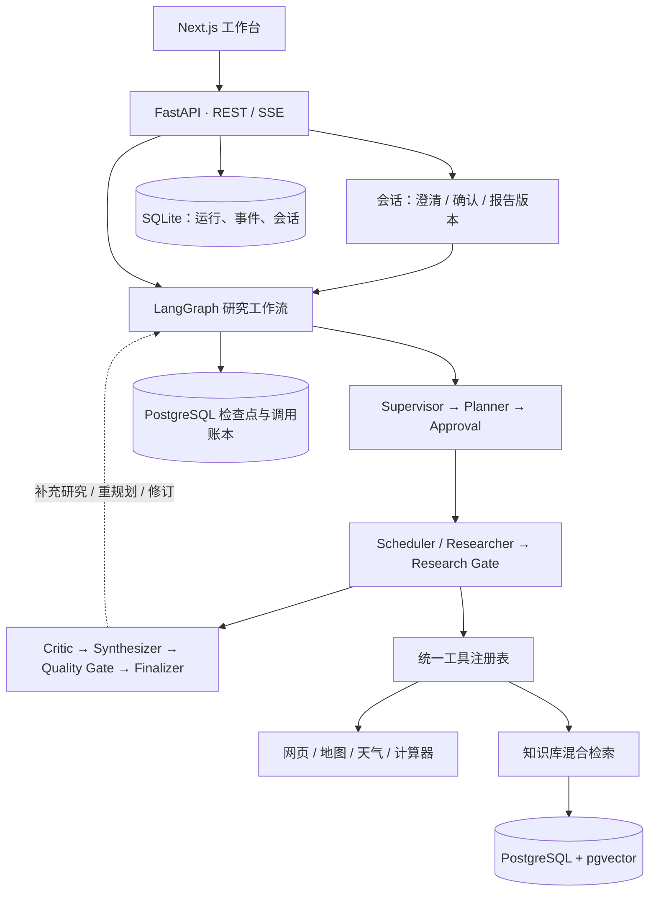

# AtlasFlow

基于 **LangGraph、FastAPI 和 Next.js** 的多 Agent 研究平台。将需求澄清、研究规划、工具检索、证据审查和报告生成串成可追踪的工作流，支持多轮报告协作、知识库检索及独立评测。

最近迭代：**v0.8.1** · [版本记录](CHANGELOG.md) · [Python 依赖](requirements.txt) · [配置模板](.env.example)

## 核心能力

| 模块 | 功能 |
| --- | --- |
| 研究工作流 | 人工审批、并行研究、证据审查、有界补充与重规划、报告质量检查 |
| 研究会话 | 需求澄清、确认后执行、补充研究、报告修订与版本查看 |
| 工具调用 | 网页搜索与读取、知识检索、计算器、高德路线与 POI、天气查询 |
| RAG 知识库 | PDF / Markdown / HTML / 纯文本导入、父子切块、中英混合检索、重排序、空间版本与快照 |
| 可观测性 | SSE 实时事件、执行轨迹、工具与证据明细、可选 LangSmith 追踪 |
| 持久化与评测 | 检查点与手动恢复；独立 RAG / Agent 实验、结果对照及 JSON / CSV 导出 |

## 工作原理



研究依据以结构化 Evidence 保存，报告保留来源与引用。RAG 采用词法与向量双路召回、融合、重排序和父块上下文组装；每次研究可选择知识空间或关闭 RAG。报告表达修订可直接进入成稿与质量检查，不重复执行完整研究。

## 快速开始

准备 **Python 3.11+、Node.js 22、npm、Conda 和 Docker / Compose**。以下使用 Windows PowerShell，以 `E:\codex\agent` 为项目目录；在其他目录运行时，请同步修改 `.env` 中的存储路径和 Compose 数据目录。

### 1. 获取代码并安装 Python 依赖

```powershell
git clone https://github.com/blank567/AtlasFlow_agent.git E:\codex\agent
Set-Location E:\codex\agent

New-Item -ItemType Directory -Force E:\codex\tmp | Out-Null
$env:TEMP = 'E:\codex\tmp'
$env:TMP = 'E:\codex\tmp'
$env:CONDA_PKGS_DIRS = 'E:\codex\cache\conda\pkgs'

conda create -p E:\conda_envs\atlasflow python=3.11 -y
conda activate E:\conda_envs\atlasflow
python -m pip install --cache-dir E:\codex\agent\.pip-cache -r requirements.txt
```

已有项目目录可跳过克隆；已有 Python 3.11+ 环境可直接使用。`requirements.txt` 以可编辑模式安装本项目，依赖及版本范围统一维护在 [pyproject.toml](pyproject.toml)。

### 2. 配置环境变量

```powershell
if (!(Test-Path .env)) { Copy-Item .env.example .env }
```

编辑项目根目录 `.env`，至少填写下列配置：

| 配置项 | 用途 |
| --- | --- |
| `LLM_MODEL`、`LLM_API_KEY` | 研究与会话模型；需支持结构化输出及工具调用 |
| `EMBEDDING_MODEL`、`EMBEDDING_API_KEY` | 文档与查询向量化 |
| `RERANK_MODEL`、`RERANK_API_KEY` | 检索重排序 |
| `KNOWLEDGE_DATABASE_URL` | PostgreSQL 连接，模板匹配 Compose 默认配置 |
| `DATABASE_PATH`、`KNOWLEDGE_BLOB_ROOT`、`KNOWLEDGE_WORK_ROOT`、`EVALUATION_STORAGE_ROOT` | 运行数据库、原文件、工作目录与评测数据路径 |

模型与 API 地址示例见 `.env.example`，模型须在自己的账户中可用。当前 Provider 装配使用 OpenRouter；LLM、Embedding、Rerank 三组配置在启动时均需有效填写。`SEARCH_MODEL` / `SEARCH_API_KEY` 留空可复用 LLM 配置。

可选配置：`AMAP_API_KEY` 启用高德工具；`LANGSMITH_TRACING=true` 并填写 Key 可启用追踪。默认 `LANGSMITH_TRACE_CONTENT=false`，不上传查询、证据与报告正文。密钥仅保存在本地 `.env`。

### 3. 启动数据库并初始化

先启动 Docker Engine，确认其数据目录位于 E 盘，再在项目根目录执行：

```powershell
$env:DOCKER_CONFIG = 'E:\codex\agent\.docker'
docker compose up -d postgres
docker compose ps
```

等待 PostgreSQL 显示 `healthy` 后执行：

```powershell
python -m alembic upgrade head
python scripts/init_execution_store.py
```

首次部署需要同时完成知识库迁移与检查点初始化，API 启动不会自动代办。升级已有实例前先停止旧 API / Worker，再执行这两条命令。若仅安装了独立版 Compose，将 `docker compose` 替换为 `docker-compose`。

Compose 默认将 PostgreSQL 数据写入 `E:/codex/agent/data/postgres`，可通过 `ATLASFLOW_POSTGRES_DATA` 覆盖；`EXECUTION_DATABASE_URL` 留空时，检查点复用知识库所在数据库的独立 schema。

### 4. 启动后端

在项目根目录、已激活的 Python 环境中执行：

```powershell
python -m uvicorn atlasflow.main:create_app --factory --app-dir backend/src --host 127.0.0.1 --port 8000
```

开发时可加 `--reload`；执行存储当前限制为单进程，不配置多个 Uvicorn Worker。API 默认在同进程处理知识库导入；需要独立导入 Worker 时，先设置 `KNOWLEDGE_WORKER_ENABLED=false`，再另启 `python -m atlasflow.knowledge.worker`。

### 5. 启动前端

另开 PowerShell 终端：

```powershell
Set-Location E:\codex\agent\frontend
$env:TEMP = 'E:\codex\tmp'
$env:TMP = 'E:\codex\tmp'
npm ci --cache E:\codex\agent\.npm-cache
npm run dev
```

| 入口 | 地址 |
| --- | --- |
| Web 工作台 | http://localhost:3000 |
| API 文档 | http://localhost:8000/docs |
| 健康检查 | http://localhost:8000/api/v1/health |

前端默认连接 `http://localhost:8000/api/v1`，自定义地址通过前端环境变量 `NEXT_PUBLIC_API_URL` 设置。开发模式首次访问页面会按需编译；需要体验生产构建时，在前端目录执行 `npm run build`，完成后使用 `npm run start`。

## 使用方式

1. 打开研究会话，输入需求；澄清后明确确认执行，按提示审批计划。
2. 在运行详情查看节点、工具调用与证据，完成后阅读、修订或下载报告。
3. 使用知识库时，先创建空间、导入文档并等待索引完成，再为研究选择该空间。
4. 在 RAG / Agent 评测页选择数据集与配置，完成预检后运行实验并对照结果。

真实研究、向量化、重排序和在线评测会调用外部服务，可能产生费用。评测中的缺失指标与警告会单独显示，测试通过不代表检索效果或报告质量已提升。

## 开发与验证

在项目根目录、已激活的 Python 环境中执行：

```powershell
python -m pip install --cache-dir E:\codex\agent\.pip-cache -r requirements-dev.txt
python -m pytest
python -m ruff check .
```

前端检查在 `frontend` 目录执行：

```powershell
npm run typecheck
npm run test:flow
npm run test:ui
npm run test:report
npm run build
```

默认后端测试使用注入的测试替身；真实 PostgreSQL 集成项通过 `ATLASFLOW_TEST_DATABASE_URL` 指向独立测试库后显式启用。线上 Provider 冒烟脚本为 `scripts/live_provider_smoke.py`、`scripts/live_workflow_smoke.py`，执行会产生真实请求。评测 CLI 可运行 `python scripts/evaluate_v2.py --help` 查看用法。

## 项目结构

```text
backend/src/atlasflow/
├── agents/           # LangGraph 工作流、模型网关、报告审查
├── conversations/    # 多轮会话、需求快照与报告版本
├── knowledge/        # 文档导入、索引、空间版本与混合检索
├── tools/            # 工具注册、调用与结果协议
├── execution/        # 检查点、调用账本与恢复
├── evaluation/       # RAG / Agent 评测
└── api/              # REST、SSE 与运行管理
backend/tests/        # 后端测试
frontend/             # Next.js 工作台及前端依赖锁文件
infra/                # PostgreSQL 初始化与 Alembic 迁移
evals/                # 数据集、参考答案与评测配置
scripts/              # 初始化、导入、评测与冒烟脚本
corpus_manifests/     # 语料来源清单
```

## 数据与边界

- 运行、事件与会话保存在 SQLite；知识索引、空间版本与执行检查点保存在 PostgreSQL；原文件与评测产物写入本地目录。备份时需要同时保留数据库与对应文件。
- 当前面向本地单用户、单进程使用，尚未提供用户认证、多租户隔离和分布式 Worker 调度。
- 进程中断后按状态显式恢复，不保证远端请求恰好执行一次；部分结果可带警告交付，证据缺口会保留在报告中。
- 空库不附带文档或预生成向量；扫描版 PDF 没有 OCR 流程。模型与工具的可用性、延迟和结果受外部服务影响。

各版本的主要变化见 [CHANGELOG.md](CHANGELOG.md)。
